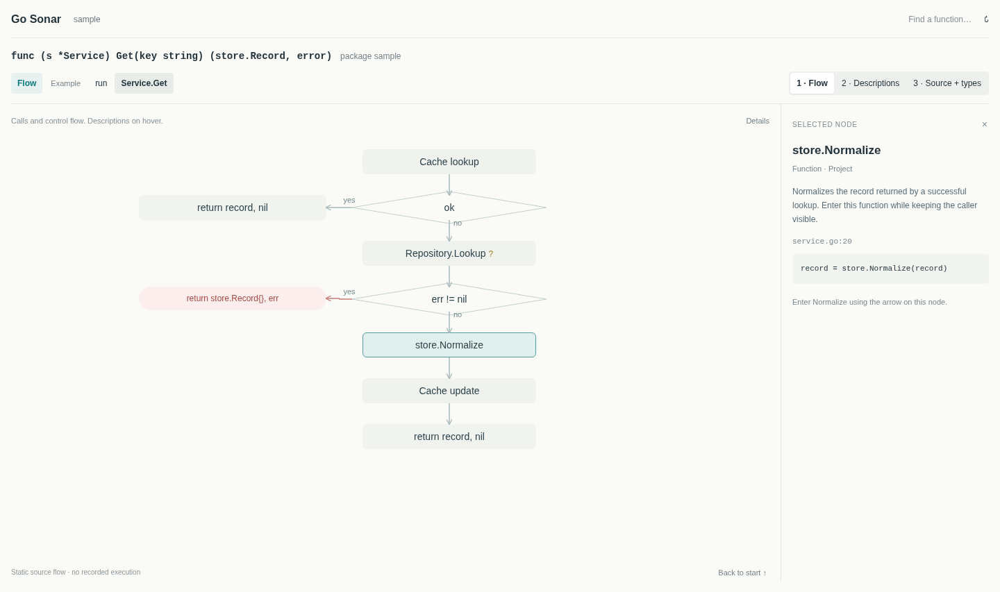
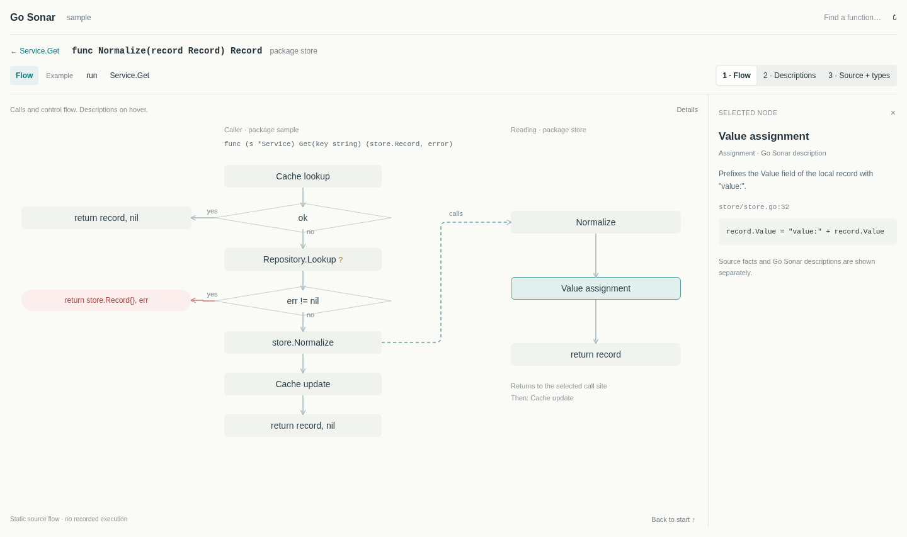
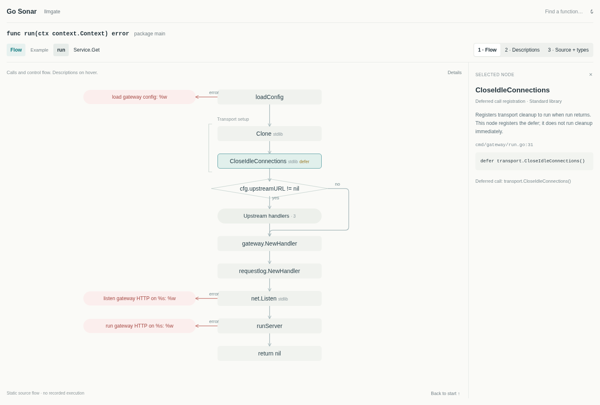

# Minimal function exploration

Status: approved design with a local implementation. The documentation checkpoint preceded code changes; implementation results are recorded in [Validation](validation.md). Screenshots below remain source-informed prototypes, not captures of the desktop app.

This specification replaces earlier presentation proposals for dense toolbars, repeated node metadata, square Flow routes, permanent legends, and automatic minimaps. Analysis scope, identities, security checks, and query bounds remain defined by the existing contracts.

## Purpose

Help a developer understand one function's flow and its connections. Start locally, follow a call without losing the caller, and reveal long functions through bounded regions. Go Sonar remains an offline source explorer without AI explanations or programming exercises.

## Three main screens

### Function flow

Show decisions, calls, early returns, and relevant operations. Descriptions and evidence appear in selection and hover. Distinct return sites retain their identities even when their expressions match.

### Enter a callee

Keep the originating caller and call occurrence visible while reading the callee. Mark the cross-function connection as a call relationship, rather than another control-flow step. Return to the exact occurrence and preserve its continuation. Deeper navigation stays bounded; do not squeeze another full pane into every call level.

### Long function

The reference shows one expanded source group and another collapsed group. Prototype counts are illustrative. The desktop uses counts from its analyzed projection.

The [interactive prototype](prototypes/minimal-ui/preview.html) demonstrates detail levels, inspection, expansion, defer registration, and the caller/callee view. Its fixture data and layout are references, not application code to import wholesale.

## Header and nodes

- Show one Go signature line and the package name. Include a receiver only when it exists. Preserve parameters and results instead of separate Receiver, Parameters, and Results columns.
- Default nodes show one name. Calls use source-resolved callable names. Non-call operations may use concise Go Sonar labels; inspection identifies their actual source kind and expression.
- Project calls have no repeated origin badge. Non-project calls have a small tag such as `stdlib` or `dependency`. Unknown origin stays unknown. Classification uses analysis metadata, not guesses from package spelling.
- Selection and hover expose descriptions, declaration kind, origin, location, signature, and limits. Highlight the selected source operation; surrounding code stays unhighlighted.
- Navigation and Expand controls appear on hover or keyboard focus. Selection, disclosure, navigation, and dismissal remain usable without a pointer.

Function, method, receiver, parameters, and results are Go concepts. Descriptions and grouped source are Go Sonar presentation concepts. A region has no callable signature or Enter function action. An interface declaration may be known while its concrete target remains unresolved; retain that uncertainty in every detail level and caller pane.

## Detail levels

| Level               | Content                                                                                                                 |
| ------------------- | ----------------------------------------------------------------------------------------------------------------------- |
| 1: Flow             | Names, calls and control structure, branch labels, return sites, origin exceptions, and essential uncertainty. Default. |
| 2: Descriptions     | Add short source-derived descriptions. Full explanations stay in inspection and hover.                                  |
| 3: Source and types | Add source ranges and available type facts. Inspection retains full declarations and expressions.                       |

Detail changes affect presentation, not analysis coverage or relationship meaning. Preserve focus, selection, call frames, and viewport while updating dimensions and routes.

## Regions and routes

- Expanded regions use a left-edge bracket, group name, and source range at level 3. Remove enclosing cards and repeated child package labels.
- Functions with fewer than approximately 12 internal nodes start expanded when the view budget permits. Larger functions start with collapsed pills and known child counts. Paging, unsupported regions, and analysis boundaries remain discoverable. The threshold is a presentation preference, not a query limit.
- Use rounded orthogonal routes in relationship and Flow views. Reserve gutters and give arrowheads one destination. Direction and certainty must remain understandable without color.
- Conditions belong on decision nodes. Edges use `yes` and `no`, without repeating the condition. Bypasses rejoin the source-defined continuation. The llmgate reference routes the `no` branch of `cfg.upstreamURL != nil` on the right to `gateway.NewHandler`.
- Preserve loops, shared identities, early returns, and unresolved boundaries. Layout must not turn a call graph into execution order or invent a continuation.

## Deferred work and error returns

Put a small `defer` marker on the registration operation. Hover and selection show the deferred call. Do not draw cleanup as immediately executed work or add floating orange explanations.

Each error return is a compact red pill beside the call or condition that leads to it. Show the actual wrapping message when available. Unwrapped returns show their expression; do not invent a message. Keep one pill per return site, its source identity and evidence, and a one-way route into the return.

## Application shell

Use the approved warm light palette, readable text, restrained borders, and compact top bar. Keep search, project controls, view choice, and detail level accessible. Put infrequent actions in named menus or expandable sections instead of repeating them across toolbar, sidebar, graph, and inspector.

Retain relationship exploration for callers, fields, types, and values. Functions start in Flow when behavior is available; unavailable behavior has an explicit fallback. Reducing chrome must not discard pagination, coverage diagnostics, source recovery, or impact queries.

## Acceptance

Verify all three screens with the real Go analyzer and Rust backend against `/Drive2/Coding_Skills/Projects/llmgate`, as a read-only target. Check that its files and existing work remain unchanged. Browser samples supplement this verification.

- Signatures and origins agree with source. Descriptions and groups remain visibly presentation concepts.
- Names stay readable; hover, selection, and detail levels expose consistent evidence.
- Entering and returning preserve the exact caller occurrence and viewport. Repeated calls, loops, and recursion stay bounded.
- Brackets, collapsed counts, defer registration, error sites, and branch destinations retain source meaning.
- Pointer and keyboard users can discover and activate navigation and expansion.
- Return selection, filters, pagination, incomplete coverage, and source recovery continue to work.

Prototype render and interaction checks passed. This does not establish native behavior, analyzer coverage, performance, or learner usability. Record implementation results in [Validation](validation.md) and use the tasks in [Exploration experience](learning-experience.md).
